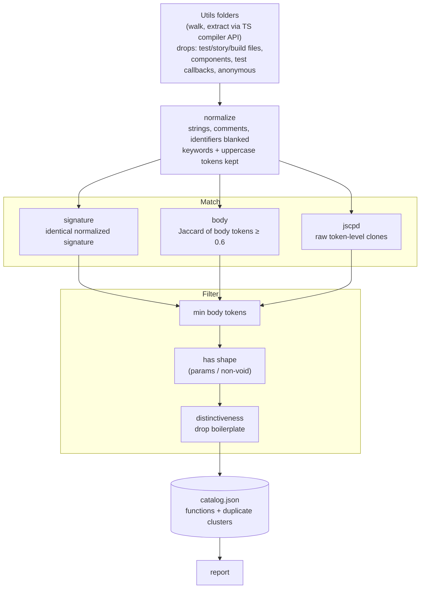

# @md-code/utils-uniqueness

ESLint rule + CLI scanner that finds **duplicate utility functions** across a
TypeScript codebase. It is the utilities counterpart of
`@md-code/react-component-uniqueness` (RCU): RCU catches duplicated React
components, this package catches duplicated plain functions.

## How it works



1. Extract functions from utils folders.
2. Normalize bodies (names blanked, keywords kept).
3. Cluster by 3 tiers: signature, body, jscpd.
4. Filter boilerplate (min tokens, distinctiveness).
5. Write catalog + report.
6. ESLint rule flags app code in a cluster.

## Quick start

```sh
bun add -D @md-code/utils-uniqueness
```

```js
// eslint.config.js
const utilsUniq = require("@md-code/utils-uniqueness/plugin");

module.exports = [
  {
    files: ["**/*.ts", "**/*.tsx"],
    plugins: { "md-code": utilsUniq },
    rules: {
      "md-code/utils-uniqueness": [
        "warn",
        {
          catalogPath: "reports/utils-catalog.json",
          utilsFolder: ["core/utils/", "core/ehr/_db/"],
        },
      ],
    },
  },
];
```

The catalog is generated automatically on the first lint when the file is
missing (from the `utilsFolder` option) — it is gitignored and never
committed. You can also generate it explicitly:

```sh
bunx md-code-utils-uniqueness --roots core/utils:core/ehr/_db --report
```

## CLI

```sh
bunx md-code-utils-uniqueness [flags]
```

| Flag | Description |
| --- | --- |
| `--roots a:b` | Utils directories to catalog (overrides `utilsFolder`) |
| `--out <file>` | Catalog output path (default `reports/utils-catalog.json`) |
| `--app-roots a:b` | Extra roots for the jscpd pass only (default: repo root) |
| `--no-jscpd` | Skip the jscpd raw-clone source |
| `--check` | CI gate — exit 1 if catalog is stale |
| `--report [file]` | Write the Markdown duplicate report |
| `--verbose` | Log per-stage counts |
| `--repo-root <dir>` | Repo root (default: auto-discovered) |

## What it flags

| Tier | Meaning |
| --- | --- |
| `signature` | Identical normalized signature (name + params + return) |
| `body` | Jaccard similarity of normalized body tokens ≥ `bodyMinRatio` |
| `jscpd` | Raw token-level clone reported by jscpd (unfiltered) |

## Options (rule config)

| Option | Default | Notes |
| --- | --- | --- |
| `catalogPath` | `reports/utils-catalog.json` | Inline catalog object or path |
| `utilsFolder` | — | Utils folders; required for the scanner when `--roots` is absent |
| `include` / `exclude` | sensible defaults | Minimatch filters for the scanner |
| `useJscpd` | `true` | Enable the jscpd raw-clone source |
| `jscpdMinTokens` / `jscpdSimilarity` | `20` / `0.7` | jscpd thresholds |
| `debt` | `reports/lint-debt.json` | Debt ledger; `false` to disable |
| `thresholds` | built-in | `minBodyTokens`, `signatureExact`, `bodyMinRatio`, `requireExported` |

## Notes

- `typescript` is bundled (v5.x) rather than a peer: the rule drives the
  TypeScript compiler API, and TypeScript 7 (the Go rewrite) ships no JS
  compiler API — the package pins its own 5.x regardless of your project.
- React components and test/story callbacks are excluded from extraction.
- The debt ledger is file-scoped: any finding in a listed file is suppressed
  (key format `<path>::<ruleId>`, shrink-only).
- Everything is plain Node + `fs`/`path` — works identically on Linux, macOS,
  Windows.
