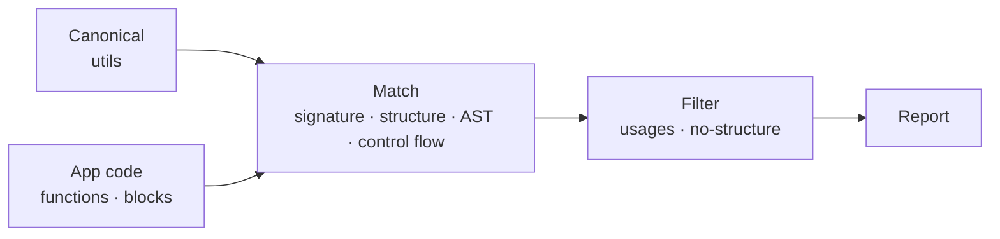

# @md-code/utils-uniqueness

ESLint rule and CLI that find utility functions that duplicate a canonical util you already have in your shared utils folder.



A candidate is compared against every canonical util on four groups of criteria, only after the function has been fully normalized and inlined:

| Group | What is compared |
| --- | --- |
| **Signature** | Canonical signature, a shape-hash of the parameter types, and the role of each parameter |
| **Structure** | The inlined/unrolled body plus a side-effect fingerprint |
| **AST** | Subtree multiset hashing + Jaccard similarity, and a structural sequence compared with Levenshtein |
| **Control flow** | The control-flow graph and a def-use summary |

Each group produces a score in `0..1`; the four are combined into a single confidence with configurable weights, then cut into `duplicate` / `similar` tiers.

## Quick start

```sh
bun add -D @md-code/utils-uniqueness
```

```js
// eslint.config.js
const plugin = require("@md-code/utils-uniqueness");

module.exports = [
  {
    files: ["src/**/*.{ts,tsx}"],
    plugins: { "md-code": plugin },
    rules: {
      "md-code/utils-uniqueness": ["error", {
        utilsFolder: ["src/utils", "core/utils"],
        parts: true,
      }],
    },
  },
];
```

Generate the catalog once before linting, and again when the canonical utils change. It is read from `reports/utils-catalog.json` and should be gitignored.

```sh
bunx md-code-utils-uniqueness
```

## Layers

`utilsFolder` is ordered: each folder is built from the ones before it. A file inside a folder is compared only with the folders to its left, so a util in `core/utils` is checked against `src/utils`, and app code outside all folders is checked against every folder. The first folder is the base and is not compared with anything.

## What it reports

| messageId | Fires when |
| --- | --- |
| `duplicateUtil` | An exported util duplicates a canonical one |
| `partOfUtil` | A block inside a function duplicates a canonical util. Needs `parts: true` |

A function that already calls the canonical util is a usage, not a duplicate, and is skipped.

## Options

| Option | Default | Notes |
| --- | --- | --- |
| `utilsFolder` | `[]` | Canonical folders, lowest layer first |
| `parts` | `false` | Also check blocks inside functions |
| `catalogPath` | `reports/utils-catalog.json` | Where the catalog is read and written |
| `include` | `[]` | Lint only matching files. Files inside `utilsFolder` are always linted |
| `exclude` | stories, tests, `*.d.ts`, `__tests__` | Globs to skip |
| `ignoreDirs` | `node_modules`, `dist`, `build` | Added to the defaults |
| `exts` | `.ts` `.tsx` `.js` `.jsx` | File extensions |
| `weights` | signature 0.3, structure 0.3, ast 0.2, controlFlow 0.2 | Signal weights |
| `thresholds` | duplicate 0.7, similar 0.5 | Confidence cut-offs |

## CLI

```sh
bunx md-code-utils-uniqueness [flags]
```

Options are read from the rule in `eslint.config.js`.

| Flag | Description |
| --- | --- |
| `--report [file]` | Write a Markdown report of every finding (default `reports/utils-duplicates.md`) |
| `--check` | Exit 1 if the catalog is stale |
| `--roots a:b` | Canonical folders, instead of `utilsFolder` |
| `--app-roots a:b` | Folders to scan for the report (default: repo root) |
| `--repo-root <dir>` | Repo root (default: auto-detected) |
| `--out <file>` | Catalog path |
| `--include a.ts:b.ts` | Only scan matching app files |
| `--ignore-dirs a:b` | Extra directories to skip |
| `--thresholds dup:sim` | Confidence cut-offs, e.g. `0.7:0.5` |
| `--parts` | Also report blocks inside functions that duplicate a canonical util |
| `--config file` | Read rule options from a specific `eslint.config.js` or options file |
| `--min-cluster N` | Min app utils matching one canonical to flag it as a missing util (default 3) |
| `--log file` | Write a per-stage JSON log |
| `--verbose` | Also list what the filters dropped |

Rule options (`weights`, `thresholds`, `parts`, `include`, `ignoreDirs`, `utilsFolder`) are always read from the consumer's `eslint.config.js` (rule `md-code/utils-uniqueness`) or `md-code-utils-uniqueness.config.js`; `--config` points to a specific file. CLI flags override the config.

## Pipeline

The package is a five-stage pipeline that mirrors `@md-code/component-uniqueness`:

```
playgrounds/typescript.js   parse functions + blocks into descriptors
normalize/                  signature · tree · control-flow · ast · candidate
matcher/                    one matcher per group → {score, evidence}
decision-maker.js           weighted confidence → duplicate / similar tier
filter/                     drop usages, drop no-structure, cluster missing utils
report.js                   Markdown report
```

- **`playgrounds/typescript.js`** — parses each file with the TypeScript compiler API (no type checker; types come from explicit annotations). Skips React components, test callbacks, and anonymous functions. `parseParts` also extracts blocks of ≥3 statements for the `parts` check.
- **`normalize/`** — turns each descriptor into a candidate carrying a signature, a plain body tree, a side-effect fingerprint, a control-flow graph, and an AST summary.
- **`matcher/`** — `matchSignals(candidate, canon)` returns the four group scores.
- **`decision-maker.js`** — `decide` combines the scores into a confidence and a tier; `bestOf` picks the strongest canonical match.
- **`filter/`** — drops composition (a function that calls the canonical util) and structure-less candidates, then clusters repeated app-side matches into "missing util" suggestions.
